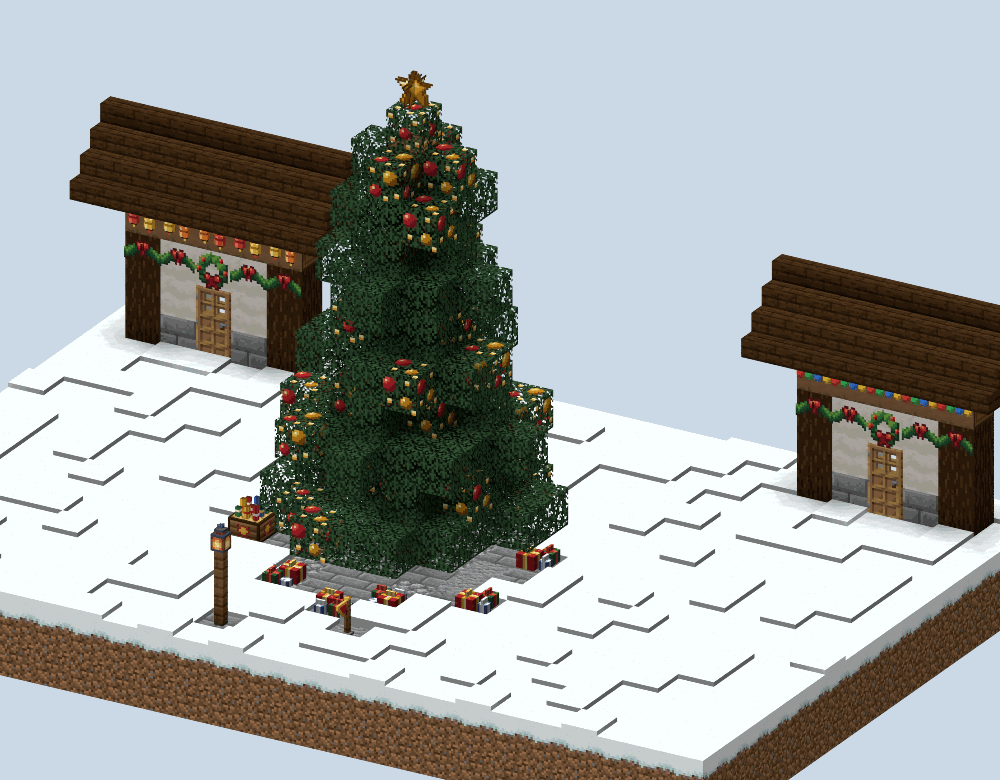

# Colony Seasons

*Seasons and festivals for MineColonies.*

Colony Seasons gives a MineColonies colony a calendar. The game has seasons, and the festivals come on
real dates. In December a new worker, the **Decorator**, hangs wreaths and garlands on the colony's
buildings and builds a decorated tree on the square. Colonists put on striped scarves, they gather
at the tree on the Winter Festival days (24 to 26 December), the player picks up a small gift every day, and
New Year ends with fireworks. After 6 January the Decorator takes everything down again.

Version 0.2.0 adds the **Town Square**, a building you place and the Builder builds, in five levels, that the Decorator
decorates by season and festival and where the gathering and the gifts happen. It also adds the **Decorator's wand**,
which marks spots in the colony for snowmen, lantern posts, garlands and planters, and, with Trade Post for MineColonies
installed, festival market stalls on the square that pay the colony a little.

Made by **Lovkar & Claude** for NeoForge 1.21.1.

Needs NeoForge 1.21.1 and MineColonies 1.1.1420 or newer in the 1.1 line (with Structurize and Domum
Ornamentum, which MineColonies needs anyway). Serene Seasons is optional. Install it on the server and
on every client.

## The calendar

There is one calendar per world, so neighbouring colonies always agree. The game year is 48 game days
long by default, twelve to a season, so a season lasts about four hours of play. A new world starts in the season
of the real date (as in the northern hemisphere), so a colony founded in December starts in winter. You can change
the year length, the starting season and the time zone in the config.

Festivals do not follow the game year. They follow the real date on the server, and every date can be
changed in the config.

| What | Default dates | What happens |
| --- | --- | --- |
| Winter decorations | 1 December to 6 January | decorations go up from the first day and stay; the tree stands; one small gift a day |
| Winter Festival | 24 to 26 December | the gathering at the tree, a better gift |
| New Year | 31 December to 1 January | fireworks at dusk, and a countdown and a big show at midnight if the server runs through it |
| Take-down | from 7 January | the Decorator removes everything he put up |

If Serene Seasons is installed, Colony Seasons follows its calendar instead of its own and says so in
`/colonyseasons status`. It does this by reflection, so Serene Seasons is not a dependency. If anything goes
wrong while reading it, the mod goes back to its own calendar for the rest of the session and writes one line
to the log.

While the effects below are off, a season changes nothing in the world: no snow, no leaf colours, nothing
placed. What shows is the clothes, the season and the day in the Decorator's hut window and in
`/colonyseasons status`, and one chat line to the colony's players when the season turns.

## The Decorator

The Decorator is a new MineColonies job. His building is the **Decorator's Workshop**, levels 1 to 5, with
room for one worker. Creativity is his main skill (how fast he puts decorations up) and Dexterity the second
(how fast he makes them). He needs no research, so a young colony can join in the festival.

A new Workshop gets its worker in MineColonies' usual order: a colonist with no job goes to the oldest hut
with a free place first. While other huts have free places, hire the Decorator in the Workshop's window. There
you can also hire a colonist who works at another hut, however far away that hut is; he leaves his old job.

While decorations need materials and the Workshop's "Prepare all year" setting is on (both are the default), he
keeps a stock of each of the six decorations he makes (wreath, garland, lantern string, fairy lights, ornament
leaves and tree star) ready at his Workshop all year, up to a cap of 8 plus 8 for each Workshop level (16 of each at
level 1, 48 at level 5). The tinsel leaves, the large star, the gift pile and the firework crate cost nothing and are
never stocked. For a decoration below the cap he looks in this order:

1. his own storage: the Workshop's racks, the hut block and his pack, where last year's decorations went after
   the take-down;
2. the colony's warehouses: if they hold finished decorations of that kind, he asks for them and a courier
   brings them;
3. only for the rest does he order the materials, such as leaves, string, dye, paper, torches, glass panes,
   gold nuggets and glowstone dust, and assemble the decorations at his hut.

The recipes are datapack files in `data/<namespace>/decorator_kits/` (the mod's own are in
`data/colony_seasons/decorator_kits/`), so a pack maker can change them. The hut window lists what he is
missing. For the tree he also asks the warehouse for spruce logs and leaves (and at level 5 for the stone bricks,
podzol and lanterns of its planter), and for the New Year show for firework rockets. With the Workshop's "Prepare
all year" setting off he only starts once a decoration window is open. If you would rather not run a supply chain,
set `decorator.needsMaterials` to false and decorating is free.

When the window opens he walks from building to building, the town hall first, then the festival square, then the
building nearest his Workshop, and puts up what his hut level allows. He starts at most 2 buildings a game day plus
2 for each Workshop level. A higher level means more decorations on each building and a bigger tree:

| Workshop level | On each building | On the square |
| --- | --- | --- |
| 1 | a wreath on the main door | small village spruce |
| 2 | and garland, two on each side | small village spruce, a pile of gifts |
| 3 | and lights, two on each side; garland three | full-size spruce, a firework crate |
| 4 | garland and lights four on each side | full-size spruce with more ornaments |
| 5 | up to six on each side, the second door too | the grand tiered tree with the large star |

With `decorator.needsMaterials` on, the parts of the square that cost nothing (the gift pile, the firework crate,
and at level 5 the large star and the tinsel leaves) wait until every part of the tree and its planter that needs
materials is up. With decorations free everything goes up together, the trunk first and then from the bottom up. The
trunk looks like spruce logs but is the mod's own block, so a Forester never takes the festival tree for a tree to
cut. Colonists standing where the tree goes are moved aside first, and he never puts a block into a cell where a
player or an animal stands; that cell waits for a later visit. A cell of the square that cannot be filled for now
(someone standing in it, a lantern with grass where its planter brick should be) does not hold him up: after a few
tries he goes on to the other buildings and tries again the next day, and the tree is ready to light as soon as the
tree itself stands.

While the window lasts he looks over his work once a game day and puts back what went missing, the gift pile too. On
the Winter Festival days he stands at the tree in the afternoon, when it does not rain, and hands the colonists
gifts. On the New Year evenings he stays up past his bedtime to launch the dusk show at the square with his rockets;
when he cannot (it rains, he is ill, the colony is raided, or the mixin below is not applied), the server launches
it with his rockets instead, and the midnight show always comes from the server. After the window he visits every
building he decorated, takes his decorations down and keeps them in his Workshop for next year.

### The Workshop's storage

The Workshop keeps his stock in MineColonies racks, 2, 3, 6, 9 and 12 of them in the hut at levels 1 to 5. At levels
1 and 2 they stand in the storage room in the back corner of the ground floor; from level 3 the storage room is the
attic, with 2, 4 and 6 of the racks, and the others stay on the ground floor's back wall. At level 5 the
window's Storage tab offers **Upgrade Storage**, as the Warehouse does at its last level: each step costs one
emerald block (nothing in creative) and makes every rack of the Workshop one row of nine slots larger, three steps
in all (27, 36, 45 and then 54 slots). You need the right to manage the colony's huts and must stand within 15
blocks of the Workshop.

He dresses the storeroom himself. Outside the festival, labelled boxes and coils of decorations stand packed on its
barrels. From the first day of the decoration window until his take-down is done, the boxes are nearly empty, the
coils are gone, and garland, a wreath and fairy lights hang on its walls. With the Workshop's "Decorate" setting off
the room stays packed. He changes the room whenever he is at his hut, for free, so its pieces drop nothing when
broken. Set `decorator.storeroomDressing` to false (it sits with his other keys in the `decorator` section) and the
room stays bare, and whatever is in it comes off.

### Where decorations go

There is no list of doors in MineColonies, so the Decorator finds them the way a player would. He looks
through the building for doors and works out which side is the outside. He hangs the wreath on the wall just above the
main door (or one block higher, or beside the door when there is no room above it), the garland to the left and
right of it and the lights in the row above, as far as there is a wall to hang them on. Where an upper floor or a
roof of whole blocks juts out over the door by up to two blocks, they hang on its front. A building with no door to
the outside (a house whose only doors are inside counts) gets one wreath on the outside wall nearest its hut block,
and no garland or lights. A building with no free wall gets nothing, which is fine. A building keeps its kind of
lights: some get paper lanterns and some get small coloured bulbs.

The Decorator only places a block into empty air, in loaded chunks, inside his own colony's claim. He
writes every block he places into a list that is saved with the world, and he only takes away a block that
is on that list and still looks exactly like what he put there. The one exception is a spruce leaf of the
tree that only changed how far it is from the trunk (the game does that when a neighbouring block changes):
it still comes down with the tree. Something a player built, or something the Builder cleared, is never
touched. A building that is being built or upgraded is skipped, and his decorations come off it first. If the
colony has no Decorator any more when the window ends, the server takes the decorations down by itself as the
chunks load; the items go into the colony's Decorator's Workshop if it still has one, and are lost if it has none.

The decorations are ordinary blocks with crafting recipes, in a creative tab called Colony Seasons, so you
can decorate by hand as well. The Decorator ignores blocks you place yourself. A decoration he put up for free
(with `decorator.needsMaterials` set to false, or a piece he took no material for) drops nothing when it is
broken, and neither do the gift pile and the firework crate of the tree; one he paid for drops its item as
usual. Blocks you placed yourself drop as usual.

### The hut window

The Decorator's Workshop has a **Calendar** page in its window. It shows today's season and the day of the
year, the festival that is on (or the next one and how many days away it is) with its dates, what the
Decorator is doing right now, a line in red while the tree does not fit at the festival marker, how many
decorations are up and how many buildings are done, how many buildings he has started today of his daily
number, the stock of each kit against the hut's cap, which materials the next kit still lacks, and what the
three effect switches do on this server. Under the list, always in view, is a Discord / Support line with the
two links as text (see Links below). Everything is translated for each player; the server only sends numbers,
ids and lang keys.

The **Settings** page has five more switches besides "Prepare all year": "Decorate" (off: he puts nothing up and
tends nothing, but still makes stock and still takes everything down afterwards), and one each for wreaths,
garlands, lights and the tree. A switched-off kind of wreaths, garlands or lights is left out of his plan: he puts
up none of it, and what is already standing stays until the take-down. Switching the tree off stops him starting a
tree, and a tree he is still building stays as it is. A finished tree, or one he planned and found no room for, is
still looked after every day until the take-down: missing parts are put back, a planned tree goes up once there is
room, and after a Workshop upgrade the old tree comes down and no new one goes up. The **Storage** page holds
Upgrade Storage (see above).

## The festival marker

The tree stands where you want it. Place a **Festival Marker** on the square, inside the colony's claim, and the
Decorator builds the tree there, facing the way the marker faces. The marker counts only when a player places it by
hand: a marker set with a command or pasted with a blueprint does not. Without a marker there is no tree, no gift
pile and no fireworks, but the buildings are still decorated. A colony has one marker: if you place a second one,
the colony's managers get one chat line saying that only the first one counts. Break the marker and the tree comes
down with it; a second marker that stands elsewhere does not take over, so place one again. If something is in the
way of the tree, he builds the rest when at most a tenth of it is blocked and none of that is the trunk. Otherwise
he builds nothing: the Workshop's Calendar page says that the tree does not fit, and the colony's managers get a
chat line once a game day that there is not enough room at the festival marker. Once the way is clear, he builds
the tree on his next visit and the line goes.

## The Town Square

The Town Square is a building of its own, levels 1 to 5, 21 x 21 blocks at every level. Craft the hut block (the
notice board), place it in the colony's claim and let the Builder build it, as any MineColonies hut. It has no worker
of its own: one Decorator is assigned to it, on its Decorator page or by the usual auto-hire, and he stays employed at
his Workshop. Without a Town Square nothing changes: a colony with only a festival marker works as in 0.1.0.

A colony has one **main square**: the built Town Square of the highest level (when two have the same level, the one
that was the main square stays). Only the main square is decorated, and it takes over from the festival marker. A second
square tells the colony's managers once that only the main square is decorated.

| Square level | What the building has |
| --- | --- |
| 1 | a paved centre with a ring of path, the notice board, two benches |
| 2 | wider paving, four lamp posts |
| 3 | a low edge wall, four planters, four more benches |
| 4 | two stall pads, four more lamp posts |
| 5 | full paving, the bandstand in the corner, two more planters and benches, two more stall pads |

While a work order is open on the square (building or upgrading), its decorations come down at once, by the exact-state
rule of the take-down, and go back up when the Builder is done. If the square is removed, the festival marker, if the
colony has one, is the centrepiece again.

### The order

The square's window has a Settings page with an order, a button that cycles three values:

- **Follow the calendar** (the default): the active festival's set in its window, small seasonal touches in the
  planters the rest of the year.
- **Always Winter Festival**: the square wants the Winter Festival's set whenever a festival window is open, whichever
  festival it is, and keeps the planters' touches between the windows (full sets come only in festival windows).
- **Bare**: the Decorator puts no set on the square. The festival's fixtures and events still happen there.

The order never changes the events. The gathering, the gift pile at the square's `gift` cell (from square level 1), the
firework crate at its `launch` cell (once the square and the Workshop are both at level 3 or more) and the New Year shows follow the real calendar under every
order, Bare included. A saved order this version does not know reads as Follow the calendar, with one log line. A changed
order takes the old set down first, every item back to the Workshop.

The tree on the square is the Winter Festival's tree, sized by the lower of the square's level and the Workshop's level,
and turned with the square. It has a foot of its own in the square's centre cell. The square's window also has an info
page: its level, the order, the set that is wanted and the one that stands (up, being built, coming down, waiting for
materials, no room), the next change of set, the Decorator (or "No Decorator: assign one on the Decorator page"), what
the last visit lacked, and what the next level adds. The Workshop's Calendar page has one line about the square: its
level, set and state, "festival marker", or no square.

### The gathering and the events

With a main square, the colonists gather at the tree cell and stand on the square's `gather` spots (the 0.1.0 ring only
when a square has none), its hut is the colony's leisure site in the gathering hours, the tree is lit from there and the
lighting rockets go up from its tree cell, and the New Year shows leave from the crate. Who comes and when is as before
(`events.whoComes`).

### Seasonal touches in the planters

Between the festivals the Decorator puts the in-game season's touch in every planter of the main square: flowering azalea
leaves in spring, azalea leaves in summer, a pumpkin in autumn, spruce boughs in winter, swapped in one visit when the
season changes. They come down for a festival window whose set this version ships (the Winter Festival), under the order
Bare, and for any work order on the square, and come back when the square's set is gone again. They are free, never count
as "decorations up", and a broken one drops nothing.

### Moving from the festival marker

Nothing converts by itself. A 0.1.0 world loads as before and keeps its marker's tree. When a Town Square reaches level 1
and no work order is open on it, the Decorator takes the marker's tree down (items to the Workshop), the colony's managers
get one chat line that the festival marker is not used while the Town Square stands, and he builds the set on the square
from those items. The marker block and its registration stay as the fallback. A marker placed after the square gets the
same line. A colony never has two centrepieces.

## The Trade Post stalls

Optional. With **Trade Post for MineColonies** installed and `compat.tradePostBridge` on (the default), a Town Square of
level 4 or more puts up festival market stalls while a festival set stands: two stripped spruce posts, a counter of slabs
and red-white-red striped wool on each stall pad (2 stalls at level 4, 4 at level 5). On festival days, in the gathering
hours, colonists at the stalls buy: each sale takes one festival good the Workshop holds above one batch of it and pays
the colony that good's price into Trade Post's balance, the one that shows as "Impact" on the Town Hall. A stall sells
only the Decorator's festival goods (wreath, garland, lantern string, fairy lights, ornament leaves, tree star), never
the gifts. The cap is one Trade Coin of Trade Post per standing stall per colony day (2,000 points at level 4, 4,000 at
level 5 with the default coin value of 1,000). The square's info page shows "Market: X today of Y".

The mod keeps no money of its own and mints no coins: it adds to MineColonies' own colony statistic that Trade Post
reads. Each payment is read back and written to the colony's record first, so a restart pays nothing twice. If anything
looks wrong the stalls stop paying until the next server start, with one warning in the log. Without Trade Post, or with
the switch off, the square works exactly as without the stalls: no stall, no money line, no log line.

## The Decorator's wand and the street pieces

The Decorator's wand (a stick, a string and a red dye, in the Colony Seasons tab) marks spots in the colony where the
Decorator puts a street piece in every festival window:

- **Right-click in the air** picks what goes on the next spot: a snowman (the default), a snowman with a top hat, a
  lantern post (a crook with a lantern), a garland between two posts, or a seasonal planter. The mode is kept on the wand.
- **Right-click a block** marks the cell in front of the clicked face. A garland takes two clicks, on two marked lantern
  posts at the same height, in a straight line, with 1 to 9 blocks between them.
- **Sneak and right-click** a mark removes it, and takes the pieces down at once (a post takes its garland with it).
- The holder of a wand sees the colony's marks as outlines.

A mark needs the colony's claim, the right to manage the colony's huts, empty air, and ground under a snowman or a post
(a dirt path counts) or a full block under a planter. A mark is refused inside any building's box, the Town Square's
included, and within 5 blocks of the festival marker. A colony has at most 64 marks.

In every festival window the Decorator dresses the marks after the town hall and the square, before the other
buildings; all marks of a colony share one slot of his day's budget. The pieces are free, have collision (the spot is the
one the player chose) and are not solid, so a dirt path under them stays a path. A mark with a body in its cells waits
for a later visit. The planter follows the in-game season like the square's touches. The lantern posts come on with the
tree's lighting. After the window the pieces come down by the ledger rule; the marks stay for next year.

`decorator.streetLights` (off by default) adds thin fairy lights on every third fence or wall post beside a path block
in the claim, outside the buildings, at most 48, with no collision. They are one group, taken down like the other
decorations, and never put up while the Workshop's lights kind is off.

## What the player does in December

- Watch the colony fill with decorations over a few game days, and place the festival marker where the tree
  should stand, or build a Town Square (see above).
- Light the tree. When the Decorator has finished it, the colony's players are told. A right-click on the
  tree lights the ornaments, the star and the strings of lights on the buildings, with a chime and a few rockets.
  If nobody does it within two game days, the Decorator lights it himself.
- From Workshop level 2, take one gift a day from the pile at the foot of the tree (on a Town Square the pile has
  its own cell and comes from level 1; `events.giftsPerPlayerPerDay`, 0 turns the gifts off). MineColonies' colony protection decides who may click the pile, so a visitor gets none. A
  gift opens into a roll of a loot table (`colony_seasons:gifts/winter_daily`, `gifts/winter_festival` and
  `gifts/new_year`), so a pack maker can change what is in it.
- On 24 to 26 December, come to the gathering. In the afternoon of the game day, when it does not rain, the
  colonists walk to the tree, the Decorator hands them gifts, and a short tune plays. The gift of these days is
  better.
- On New Year, watch the fireworks from the square at dusk. If the Decorator has no rockets yet, the show
  waits through the dusk for them. The gift of the day holds a few rockets.

By default, once per real day every colonist comes to the gathering, so work stops for those afternoon hours
on one game day. The guards stay at their posts. On the other game days of the festival only colonists who are
off duty come. You can change that with `events.whoComes`. To bring working colonists too, the mod uses one small
mixin that is written to fail quietly: if a MineColonies update moves the method it hooks, the mod still loads and
only off-duty colonists come.

## Clothes

Colonists and visitors wear a knitted scarf in in-game winter, in red, green, blue, mustard or plum. The colour is
picked from the colonist's id, so he keeps it. From 1 December to 6 January, the Winter Festival's decoration
window, the scarf is a striped festive one instead, whatever the season in the game. In in-game winter, colonists
whose model has no headgear of its own also get a wool hat in their own colour, the one of their plain scarf; while
the scarf is the striped one, the hat keeps that plain colour. It is never drawn over a helmet, or when MineColonies
shows its own December hat; the scarf still is. A colonist in a chestplate, such as a guard, gets no scarf.

This is drawn on the client only, as one extra layer on MineColonies' colonist renderer. Nothing is put in
an inventory slot and nothing is saved on the colonist. To turn it off, set `showClothes` to false in the client
config `colony_seasons-client.toml`.

## Effects on the game

There are three switches in the server config, all off by default. With all three off the mod changes looks, sounds,
the materials the Decorator uses, the gifts and the festival gathering, and nothing else. By default, on each real
day of 24 to 26 December, working colonists (not the guards) leave work for the gathering hours of one game day (see
the gathering above); `events.whoComes = off_duty` keeps them at work. On the New Year evenings the Decorator stays
up past his bedtime for the dusk show.

| Switch | When on |
| --- | --- |
| `effects.festivalHappiness` | on festival days every colonist gets a happiness bonus |
| `effects.winterCropSlowdown` | in in-game winter, crops inside colony claims skip some of their growth steps |
| `effects.winterFoodNeed` | in in-game winter, colonists use more food |

How strong each one is: `effects.festivalHappinessBonus` (1.0 happiness points, of the 0 to 10 MineColonies
shows), `effects.winterCropSkipChance` (0.5: half the growth steps) and `effects.winterFoodNeedFactor` (1.25:
a quarter more food). "Winter" is winter in the game's calendar (or Serene Seasons'), never the real date; a
festival day is a real-date festival day, and the forced festival counts.

Two things these switches cannot do, both proven on a test server and both stated here on purpose:

- **The happiness bonus is not listed in the citizen window.** MineColonies keeps only its own fixed list of
  happiness reasons across a world load and shows only those in the citizen window. The bonus is a reason of
  our own (`colonyseasons_festival`), so the server puts it back on every colonist every five seconds while
  festival days last, and takes it off when they end. It counts: the happiness number a player is shown is the
  server's number with the bonus in it, and the test checks that the two are equal. Only the list of reasons
  behind the number leaves it out. The Decorator's hut window says whether the bonus is on and how big it is.
  Nothing of it is saved, so removing the mod leaves nothing behind.
- **MineColonies' own crops are not slowed down.** The crop switch vetoes growth steps that go through the
  game's crop growth event, which the vanilla crops fire (wheat, carrots, potatoes, beetroot and so on).
  MineColonies' own crops (bell pepper, cabbage and the others it adds) grow through their own code, which
  never fires that event, so they grow at their usual speed. The test made one of them try to grow 4000 times
  and counted no event.

The food switch looks at each colonist's hunger every five seconds and takes the extra share of what he used since
the last look on top (a quarter with the default factor). A colony that nobody is near does not get hungry on its
own, so there it takes nothing.

## Config

The server config is `colony_seasons-server.toml`. Every key has a comment, and every default is a named
constant in `SeasonsConfig.java`.

| Section | What it holds |
| --- | --- |
| `calendar` | year length in game days (48), starting season (`auto`), whether to follow Serene Seasons (true), time zone (`system`) |
| `festivals` | for each festival: on or off, the first and last day of decorations, the first and last festival day |
| `decorator` | whether he needs materials (`needsMaterials`, true), how many buildings he starts per game day (`buildingsPerDayBase` 2, `buildingsPerDayPerLevel` 2), the most decorations on one side (`maxPerSide`, 6), whether he dresses his Workshop's storeroom (`storeroomDressing`, true), whether he hangs thin street lights (`streetLights`, false) |
| `events` | when the gathering starts and ends (game ticks 8500 and 10500), who comes (`everyone_once_a_day`), the midnight show (true), gifts per player per day (1) |
| `effects` | the three switches above (all false) and how strong each one is |
| `links` | `showWelcome` (true): the one chat line with the Discord and Patreon links (see Links) |
| `compat` | `tradePostBridge` (true): the Trade Post stalls and their payments; does nothing without Trade Post |

## Links

Colony Seasons is made by Lovkar & Claude. News, help and test builds are on Discord at
https://discord.gg/BVztrTtXFu, and you can support the mods on Patreon at https://www.patreon.com/cw/Lovkar. Both
links are in the mod's description, under the list of the Decorator's Workshop Calendar page, and in one chat line
the server sends a player the first time he joins a world with the mod. That line comes once per player in each
world and never again there. The mod remembers it with a marker in the player's saved data (in the persistent data,
the compound `PlayerPersisted`, then `lovkar_mods`, the boolean `welcome_shown`), which the game keeps through death
and the return from the End. The marker has a neutral name so the author's later mods can share it. A server owner
turns the line off with `links.showWelcome = false` in `colony_seasons-server.toml` (default true); with it off no
marker is written.

## Commands

| Command | Who | What it does |
| --- | --- | --- |
| `/colonyseasons status` | everyone | the season, the day, which calendar is in use, which festivals are on |
| `/colonyseasons season set <season>` | operators | moves the game calendar to a season |
| `/colonyseasons festival force <id>` | operators | starts a festival outside its dates; it stays on, and is saved with the world, until you clear it |
| `/colonyseasons festival clear` | operators | ends a forced festival |
| `/colonyseasons decor list [colony]` | operators | counts the decorations the Decorator has placed in this dimension; with a colony id, a `Centrepiece:` line first (the Town Square and its tree cell, the festival marker, or none), then each building, square, storeroom, marked spot and the street lights on its own line |
| `/colonyseasons decor remove <colony>` | operators | removes every decoration the list holds for that colony in this dimension, by the same rule as the take-down |

The festival ids are `winter_festival` and `new_year`. With Serene Seasons installed, `season set` leaves
the game alone and says so; use Serene Seasons' own command.

## What it does not do

- Only the Winter Festival and New Year are in this version; other festivals come later.
- No Decorator, no decorations. Without his hut the colonists still dress for the season, players still get
  the season line, and on the Winter Festival days the colonists still gather at the Town Square or the festival
  marker (at the town hall without either), but there is no tree, no gift pile and no fireworks.
- Streets are decorated only where you mark them with the wand (and with the optional thin lights beside paths).
  MineColonies has no road network to hang things on, and solid blocks on a street can block colonists, so the
  Decorator never picks a street spot himself.
- Only the colony's main Town Square is decorated, and the stalls need Trade Post for MineColonies.
- Festival dates are read from the server's clock. On a hosted server in another time zone, set
  `calendar.timeZone`.
- The happiness bonus is not listed in the citizen window, because MineColonies only shows its own fixed
  list there. The total is right, and the Decorator's hut window shows the bonus.
- MineColonies' own crops grow through their own code and do not take part in the winter slowdown. Vanilla
  crops inside a claim do.
- The text is English only.

If you take the mod out of a world, run `/colonyseasons decor remove` for each colony first. The decoration
blocks disappear with the mod (the tree's trunk too), but the spruce leaves of the tree stay where they are, and
at level 5 also the stone bricks, podzol and lanterns of the grand tree's planter. On a Town Square the stalls' posts,
slabs and wool and the planters' leaves or pumpkin stay too.

## Building from source

Plain `javac` and `jar`, no Gradle. The steps, what you need and the tests are in
[BUILDING.md](BUILDING.md). History: [docs/CHANGELOG.md](docs/CHANGELOG.md).

## Licence and credits

GPL-3.0-or-later, see [LICENSE](LICENSE). Made by Lovkar & Claude. The textures, models and sounds are our
own; the ornament and tinsel leaves draw the game's own spruce-leaf texture (named in their models, not copied)
under our ornaments, the festival tree's trunk uses the game's own spruce-log models the same way, and the
Decorator speaks with MineColonies' own Florist voice lines. MineColonies, Structurize and Domum Ornamentum are the
work of their authors and are not part of this repository.
