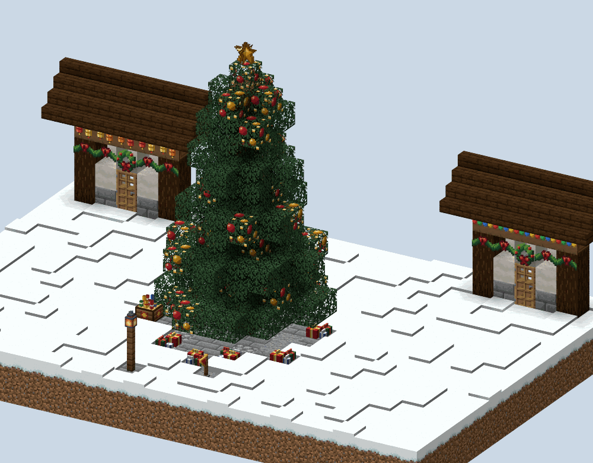

# Colony Seasons

*Seasons and festivals for MineColonies.*

Colony Seasons gives a MineColonies colony a calendar. The game has seasons, and the festivals come on
real dates. In December a new worker, the **Decorator**, hangs wreaths and garlands on the colony's
buildings and builds a decorated tree on the square. Colonists put on striped scarves, they gather
at the tree on the festival days, the player picks up a small gift every day, and New Year ends with
fireworks. After 6 January the Decorator takes everything down again.

Made by **Lovkar & Claude** for NeoForge 1.21.1.

Needs NeoForge 1.21.1 and MineColonies 1.1.1420 or newer in the 1.1 line (with Structurize and Domum
Ornamentum, which MineColonies needs anyway). Serene Seasons is optional. Install it on the server and
on every client.

## The calendar

There is one calendar per world, so neighbouring colonies always agree. The game year is 48 game days
long by default, twelve to a season, so a season lasts about four hours of play. A new world starts in the season
of the real date, so a colony founded in December starts in winter. You can change the year length, the
starting season and the time zone in the config.

Festivals do not follow the game year. They follow the real date on the server, and every date can be
changed in the config.

| What | Default dates | What happens |
| --- | --- | --- |
| Winter decorations | 1 December to 6 January | decorations go up from the first day and stay; the tree stands; one small gift a day |
| Winter Festival | 24 to 26 December | the gathering at the tree, a better gift |
| New Year | 31 December to 1 January | fireworks at dusk, and a countdown and a big show at midnight if the server runs through it |
| Take-down | from 7 January | the Decorator removes everything he put up |

If Serene Seasons is installed, Colony Seasons follows its calendar instead of its own and says so in
`/colonyseasons status`. It does this by reflection, so Serene Seasons is not a dependency. If anything goes
wrong while reading it, the mod goes back to its own calendar for the rest of the session and writes one line
to the log.

While the effects below are off, a season changes nothing in the world: no snow, no leaf colours, nothing
placed. What shows is the clothes, the season and the day in the Decorator's hut window and in
`/colonyseasons status`, and one chat line to the colony's players when the season turns.

## The Decorator

The Decorator is a new MineColonies job. His building is the **Decorator's Workshop**, levels 1 to 5, with
room for one worker. Creativity is his main skill and Dexterity the second. He needs no research, so a young
colony can join in the festival.

A new Workshop gets its worker in MineColonies' usual order: a colonist with no job goes to the oldest hut
with a free place first. While other huts have free places, hire the Decorator in the Workshop's window. There
you can also hire a colonist who works at another hut, however far away that hut is; he leaves his old job.

All year he asks the colony's warehouse for materials, such as leaves, string, dye, paper, torches and
glowstone dust, and assembles decorations at his hut so that stock is ready when the first day of the window
comes. The recipes are datapack files in `data/colony_seasons/decorator_kits/`, so a pack maker can change
them. The hut window lists what he is missing. If you would rather not run a supply chain, set
`decorator.needsMaterials` to false and decorating is free.

When the window opens he walks from building to building, town hall first and then the nearest, and puts up
what his hut level allows. A higher level means more decorations on each building and a bigger tree:

| Workshop level | On each building | On the square |
| --- | --- | --- |
| 1 | a wreath on the main door | small village spruce |
| 2 | and garland, two on each side | small village spruce, a pile of gifts |
| 3 | and lights, two on each side; garland three | full-size spruce, a firework crate |
| 4 | garland and lights four on each side | full-size spruce with more ornaments |
| 5 | up to six on each side, the second door too | the grand tiered tree with the large star |

The gift pile and the firework crate go up last, once the tree's own trunk, leaves, ornaments and star are in place.
The trunk looks like spruce logs but is the mod's own block, so a Forester never takes the festival tree for a tree
to cut. Colonists standing where the tree goes are moved aside first, and he never builds round a player or an
animal. A cell of the square that cannot be filled for now (someone standing in it, a lantern with grass where its
planter brick should be) does not hold him up: after a few tries he goes on to the other buildings and tries again the
next day, and the tree is ready to light as soon as the tree itself stands.

While the window lasts he looks over his work once a game day, puts back what went missing and refills the
gift pile. On festival days he stands at the tree, hands out gifts and sets off the fireworks. After the
window he visits every building he decorated, takes his decorations down and keeps them in his hut for next
year.

### Where decorations go

There is no list of doors in MineColonies, so the Decorator finds them the way a player would. He looks
through the building for doors, works out which side is the outside, hangs the wreath above the door and
lays garland and lights in the rows next to it, as far as there is a wall to hang them on. A building with
no door to the outside gets one wreath on the outside wall nearest its hut block, and no garland or lights.
A building with no free wall gets nothing, which is fine. A building keeps its kind of lights: some get paper
lanterns and some get small coloured bulbs.

The Decorator only places a block into empty air, in loaded chunks, inside his own colony's claim. He
writes every block he places into a list that is saved with the world, and he only takes away a block that
is on that list and still looks exactly like what he put there. The one exception is a spruce leaf of the
tree that only changed how far it is from the trunk (the game does that when a neighbouring block changes):
it still comes down with the tree. Something a player built, or something the Builder cleared, is never
touched. A building that is being built or upgraded is skipped, and his
decorations come off it first. If the colony has no Decorator any more when the window ends, the server
takes the decorations down by itself as the chunks load.

The decorations are ordinary blocks with crafting recipes, in a creative tab called Colony Seasons, so you
can decorate by hand as well. The Decorator ignores blocks you place yourself. A decoration he put up for free
(with `decorator.needsMaterials` set to false, or a piece he took no material for) drops nothing when it is
broken, and neither do the gift pile and the firework crate of the tree; one he paid for drops its item as
usual. Blocks you placed yourself drop as usual.

### The hut window

The Decorator's Workshop has a **Calendar** page in its window. It shows today's season and the day of the
year, the festival that is on (or the next one and how many days away it is) with its dates, what the
Decorator is doing right now, how many decorations are up and how many buildings are done, the stock of each
kit against the hut's cap, which materials the next kit still lacks, what the three effect switches do on
this server, and last a Discord / Support line with the two links (see Links below). Everything is translated
for each player; the server only sends numbers, ids and lang keys.

The **Settings** page has four more switches besides "Prepare all year": "Decorate" (off: he puts nothing up
and tends nothing, but still makes stock and still takes everything down afterwards), and one each for
wreaths, garlands, lights and the tree. A switched-off kind is left out of his plan; what is already standing
is not touched until the take-down. Switching the tree off stops a new tree from going up.

## The festival marker

The tree stands where you want it. Place a **Festival Marker** on the square and the Decorator builds the
tree there, facing the way the marker faces. Without a marker there is no tree, but the buildings are still
decorated. A colony has one marker: if you place a second one, the colony's managers get one chat line saying
that only the first one counts. If something is in the way of the tree, he builds the rest when at most
a tenth of it is blocked and none of that is the trunk. Otherwise he builds nothing and the hut window says
there is not enough room.

## What the player does in December

- Watch the colony fill with decorations over a few game days, and place the festival marker where the tree
  should stand.
- Light the tree. When the Decorator has finished it, the colony's players are told. A right-click on the
  tree lights the ornaments, the star and the strings with a chime and a few rockets. If nobody does it
  within two game days, the Decorator lights it himself.
- Take one gift a day from the pile at the foot of the tree. A gift opens into a roll of a loot table
  (`colony_seasons:gifts/winter_daily`), so a pack maker can change what is in it.
- On 24 to 26 December, come to the gathering. In the afternoon of the game day the colonists walk to the
  tree, the Decorator hands out gifts, and a short tune plays. The gift of these days is better.
- On New Year, watch the fireworks from the square at dusk. If the Decorator has no rockets yet, the show
  waits through the dusk for them. The gift of the day holds a few rockets.

By default, once per real day every colonist comes to the gathering, so work stops for those afternoon hours
on one game day. The guards stay at their posts. On the other game days of the festival only colonists who are
off duty come. You can
change that with `events.whoComes`. To bring working colonists too, the mod uses one small mixin that is
written to fail quietly: if a MineColonies update moves the method it hooks, the mod still loads and only
off-duty colonists come.

## Clothes

Colonists and visitors wear a knitted scarf in in-game winter, in red, green, blue, mustard or plum. The
colour is picked from the colonist's id, so he keeps it. From 1 December to 6 January, the Winter Festival's
decoration window, the scarf is a striped festive one instead, whatever the season in the game. In in-game
winter, colonists whose model has no headgear of its own also get a wool hat in the colour of the scarf. It
is never drawn over a helmet, or when MineColonies shows its own December hat; the scarf still is. A
colonist in a chestplate, such as a guard, gets no scarf.

This is drawn on the client only, as one extra layer on MineColonies' colonist renderer. Nothing is put in
an inventory slot and nothing is saved on the colonist. There is a client config `colony_seasons-client.toml`
with `showClothes` and `showParticles` if you want it off.

## Effects on the game

There are three switches in the server config, all off by default. With all three off the mod changes
looks, sounds, the materials the Decorator uses and the gifts, and nothing else.

| Switch | When on |
| --- | --- |
| `effects.festivalHappiness` | on festival days every colonist gets a happiness bonus |
| `effects.winterCropSlowdown` | in in-game winter, crops inside colony claims skip some of their growth steps |
| `effects.winterFoodNeed` | in in-game winter, colonists use more food |

How strong each one is: `effects.festivalHappinessBonus` (1.0 happiness points, of the 0 to 10 MineColonies
shows), `effects.winterCropSkipChance` (0.5: half the growth steps) and `effects.winterFoodNeedFactor` (1.25:
a quarter more food). "Winter" is winter in the game's calendar (or Serene Seasons'), never the real date; a
festival day is a real-date festival day, and the forced festival counts.

Two things these switches cannot do, both proven on a test server and both stated here on purpose:

- **The happiness bonus is not listed in the citizen window.** MineColonies keeps only its own fixed list of
  happiness reasons across a world load and shows only those in the citizen window. The bonus is a reason of
  our own (`colonyseasons_festival`), so the server puts it back on every colonist every five seconds while
  festival days last, and takes it off when they end. It counts: the happiness number a player is shown is the
  server's number with the bonus in it, and the test checks that the two are equal. Only the list of reasons
  behind the number leaves it out. The Decorator's hut window says whether the bonus is on and how big it is.
  Nothing of it is saved, so removing the mod leaves nothing behind.
- **MineColonies' own crops are not slowed down.** The crop switch vetoes growth steps that go through the
  game's crop growth event, which the vanilla crops fire (wheat, carrots, potatoes, beetroot and so on).
  MineColonies' own crops (bell pepper, cabbage and the others it adds) grow through its own code, which
  never fires that event, so they grow at their usual speed. The test grew one of them 4000 steps and
  counted no event.

The food switch looks at each colonist's hunger every five seconds and takes a quarter of what he used since the
last look, on top. A colony that nobody is near does not get hungry on its own, so there it takes nothing.

## Config

The server config is `colony_seasons-server.toml`. Every key has a comment, and every default is a named
constant in `SeasonsConfig.java`.

| Section | What it holds |
| --- | --- |
| `calendar` | year length in game days, starting season, whether to follow Serene Seasons, time zone |
| `festivals` | for each festival: on or off, the first and last day of decorations, the first and last festival day |
| `decorator` | whether he needs materials, how many buildings he does per game day, the most decorations on one side |
| `events` | when the gathering starts and ends, who comes, the midnight show, gifts per player per day |
| `effects` | the three switches above and how strong each one is |
| `links` | `showWelcome`: the one chat line with the Discord and Patreon links (see Links) |

## Links

Colony Seasons is made by Lovkar & Claude. News, help and test builds are on Discord at
https://discord.gg/BVztrTtXFu, and you can support the mods on Patreon at https://www.patreon.com/cw/Lovkar. Both
links are in the mod's description, on the last line of the Decorator's Workshop Calendar page, and in one chat line
the server sends a player the first time he joins a world with the mod. That line comes once per player and never
again, also not from Lovkar's other mods: they share one marker in the player's saved data (in the persistent data,
the compound `PlayerPersisted`, then `lovkar_mods`, the boolean `welcome_shown`), which the game keeps through death
and the return from the End. A mod that sends the line sets the marker, and every mod skips the line once it is
set. A server owner turns the line off with `links.showWelcome = false` in `colony_seasons-server.toml` (default
true); with it off no marker is written.

## Commands

| Command | Who | What it does |
| --- | --- | --- |
| `/colonyseasons status` | everyone | the season, the day, which calendar is in use, which festivals are on |
| `/colonyseasons season set <season>` | operators | moves the game calendar to a season |
| `/colonyseasons festival force <id>` | operators | starts a festival outside its dates; it stays on, and is saved with the world, until you clear it |
| `/colonyseasons festival clear` | operators | ends a forced festival |
| `/colonyseasons decor list` | operators | counts the decorations the Decorator has placed |
| `/colonyseasons decor remove <colony>` | operators | removes every decoration the list holds for that colony, by the same rule as the take-down |

The festival ids are `winter_festival` and `new_year`. With Serene Seasons installed, `season set` leaves
the game alone and says so; use Serene Seasons' own command.

## What it does not do

- Only the Winter Festival and New Year are in 0.1.0. Spring Bloom, Harvest Fair and Night of Lanterns come
  later, each before its real date.
- No Decorator, no decorations. Without his hut the colonists still dress for the season, players still get
  the season line, and on the festival days the off-duty colonists gather at the festival marker (at the town
  hall without one), but there is no tree, no gift pile and no fireworks.
- Streets are not decorated. MineColonies has no road network to hang things on, and solid blocks on a
  street can block colonists.
- Festival dates are read from the server's clock. On a hosted server in another time zone, set
  `calendar.timeZone`.
- The happiness bonus is not listed in the citizen window, because MineColonies only shows its own fixed
  list there. The total is right, and the Decorator's hut window shows the bonus.
- MineColonies' own crops grow through their own code and probably do not take part in the winter slowdown.
  Vanilla crops inside a claim do.
- The text is English only.

If you take the mod out of a world, run `/colonyseasons decor remove` for each colony first. The decoration
blocks disappear with the mod (the tree's trunk too), but the spruce leaves of the tree stay where they are.

## Building from source

Plain `javac` and `jar`, no Gradle. The steps, what you need and the tests are in
[BUILDING.md](BUILDING.md). History: [docs/CHANGELOG.md](docs/CHANGELOG.md).

## Licence and credits

GPL-3.0-or-later, see [LICENSE](LICENSE). Made by Lovkar & Claude. The textures, models and sounds are our
own; the ornament and tinsel leaves draw the game's own spruce-leaf texture (named in their models, not copied)
under our ornaments. MineColonies, Structurize and Domum Ornamentum are the work of their authors and are not part of this
repository.
